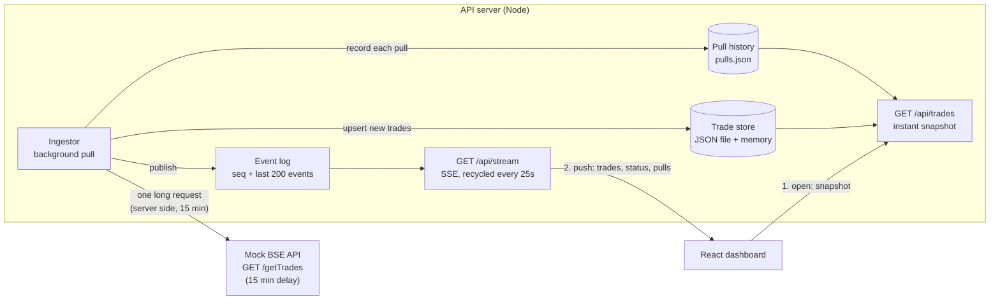

# Architecture note

## The problem

A pull takes up to 15 minutes, but the network kills any HTTP connection open for more than 30 seconds.
So the browser can never wait on the pull, and a live-update channel cannot stay open indefinitely either.

## The design

1. **The pull is decoupled from the browser.** The ingestor on the server makes the slow call to BSE and writes
   trades into a persistent store as it finishes. The browser never touches the slow endpoint.
2. **Instant open.** The dashboard calls `GET /api/trades`, which reads the store and returns in milliseconds,
   even in the middle of a pull. The store is persisted to disk, so it survives restarts.
3. **Push, not poll.** When the pull completes, the server publishes a `trades` event to every connected
   browser over Server-Sent Events. No timer in the browser asks "anything new?" and nothing on the server
   schedules pulls (a pull starts on boot or when someone presses *Start pull* / calls `POST /api/pull`).
4. **Surviving the 30-second limit.** The server ends each SSE response after 25 seconds. The browser's
   `EventSource` reconnects automatically (about 300 ms) and sends `Last-Event-ID`; the server replays every
   event after that id from its event log. Nothing is lost across reconnects. If the gap is too large (or the server restarted),
   it sends `resync` and the client reloads the snapshot.
5. **Pull history and progress.** The ingestor records every pull (ID, start, duration, record count, status and
   any error) in `pulls.json` and publishes a `pulls` event, so the Pull History page updates live and survives a
   restart. A pull that was running when the server died is marked Failed on the next start. BSE sends nothing
   until a pull ends, so the progress bar is an estimate from elapsed time against `EXPECTED_PULL_MS`.
6. **Visible connection state.** The dashboard shows whether the live stream is Connected, Reconnecting or
   Disconnected. Because the stream is recycled every 25 seconds on purpose, the badge ignores the normal
   300 ms reconnect and only changes if the stream stays down for 1.5 seconds (Reconnecting) or 8 seconds
   (Disconnected).
7. **Safe against duplicates.** Trades are keyed by trade ID on both server and client, so replays and
   overlapping pulls never create duplicate rows.

## Why SSE and not WebSockets or polling

SSE is one-way server→browser push, which is all this needs. It has built-in reconnect and event-id resume,
which is exactly what a 25-second connection lifetime requires. WebSockets would also be cut at 30 seconds
and would need hand-written reconnect/replay logic. Polling is explicitly ruled out.

## Assumptions and trade-offs

- The 30-second limit is treated as applying to browser-facing connections. The server-to-BSE call is held open
  for the full pull. If that hop were also limited, the mock BSE would need an async job API (submit, then
  receive a callback or fetch a result by id), and only the ingestor would change.
- The store is a JSON file for simplicity; production would use a database and a shared pub/sub (e.g. Redis)
  so several API instances could fan out events.
- The one-second clock in the progress bar is a local UI timer; it fetches no data.
- A pull starts only on boot or on request. Nothing re-pulls on a schedule, because the brief rules out a scheduler.
